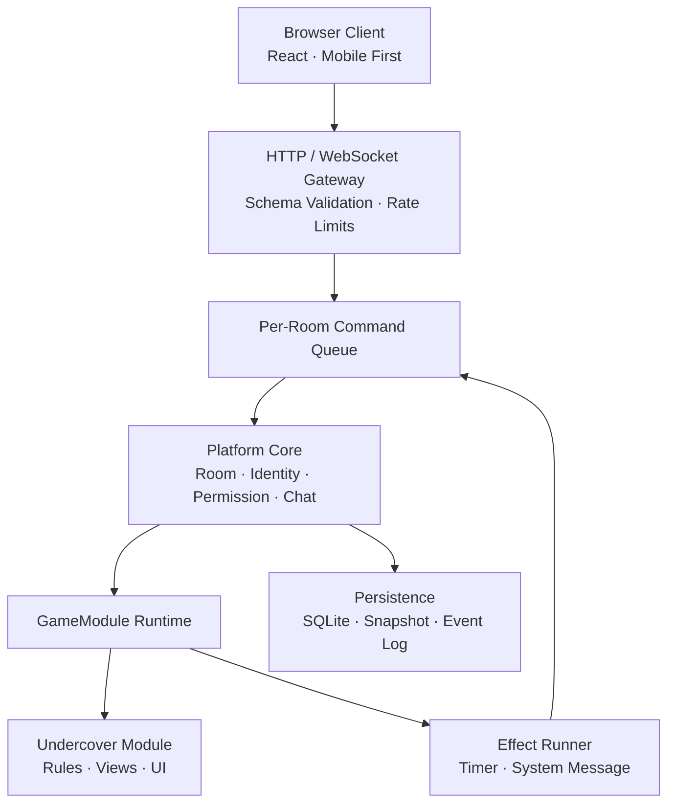
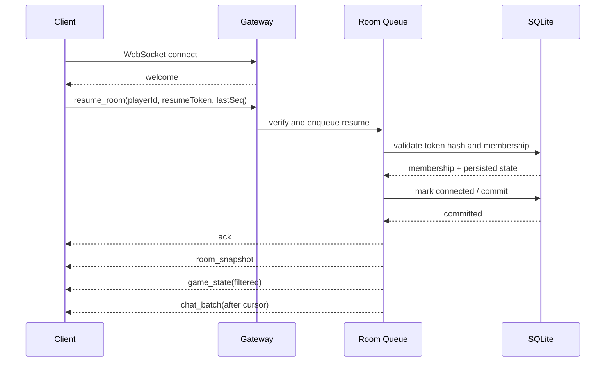

# 局域网桌游游戏平台 · 产品与技术规格说明书 v1.1

> 本版在 v1.0 的架构方向上，进一步收紧 MVP 边界，补齐首款游戏规则、异常流程、协议一致性、安全边界、恢复语义与可量化验收标准。  
> 核心原则：**先把一款游戏做完整，再用第二款游戏验证扩展性；不为尚未使用的能力提前实现复杂框架。**

---

## 0. 文档控制

| 项目 | 内容 |
|------|------|
| 文档版本 | v1.1（含 2026-07-26 实施前补遗，见附录 D） |
| 上一版本 | `SPEC-v1.0.md` |
| 状态 | **实施基线候选**：可进入任务拆分；Termux 数据库兼容性 PoC 需优先完成 |
| 目标版本 | MVP / R1 |
| 主要读者 | 产品负责人、开发者、测试者、后续游戏模块作者 |
| 核心场景 | 同一局域网内，4–12 名玩家使用手机浏览器完成桌游对局 |
| 首发游戏 | 谁是卧底 |

### 0.1 规范用语

- **必须（MUST）**：MVP 验收的硬性条件；未满足不得发布。
- **应该（SHOULD）**：默认应实现；只有记录明确原因后才可延期。
- **可以（MAY）**：可选增强，不影响 MVP 发布。
- **P0**：MVP 必须；**P1**：R1 后优先；**P2**：后续演进。

### 0.2 本版解决的关键问题

1. 将“愿景、MVP、后续路线”分层，消除 Docker、语音、私聊等能力在不同章节中的范围冲突。
2. 补齐“谁是卧底”的规则、平票、掉线、超时、终止、胜负判定等可执行细节。
3. 区分公开 `PlayerId` 与秘密 `resumeToken`，避免把浏览器本地 ID 当作重连凭证。
4. 为 WebSocket 增加请求 ID、房间序号、确认、去重、断档重同步和协议版本。
5. 明确“服务端确认前落盘”的恢复语义，使已确认操作在进程崩溃后不丢失。
6. 将性能目标拆分为“旧手机 MVP 基线”和“上云容量目标”，避免互相冲突。
7. 把“内核零改动”修正为可验收的边界：新增游戏不得修改核心执行链，只允许新增模块与注册配置。

---

## 1. 产品定义

### 1.1 一句话定位

一个**局域网优先、单机可运行、未来可上云**的网页桌游平台：聚会时一台电脑或安卓设备充当主机，其他玩家扫码即玩；新增游戏通过标准模块接入，不复制房间、通信、计时、投票和恢复能力。

### 1.2 要解决的问题

- 聚会桌游通常需要安装 App、注册账号或依赖公网，临时开局成本高。
- 每开发一款网页桌游都重复实现房间、连接、身份、重连和状态同步。
- 隐藏身份类游戏若依赖客户端保存完整状态，容易泄露秘密信息。
- 单人维护项目若过早引入微服务、Redis、账号、语音或脚本系统，极易失控。

### 1.3 产品目标

| ID | 目标 | MVP 成功信号 |
|----|------|--------------|
| G-01 | 低门槛开局 | 主机启动后展示可访问地址与二维码；玩家无需注册即可加入 |
| G-02 | 完整可玩 | 4–12 人可连续完成至少 3 局“谁是卧底”，无需服务端人工修数据 |
| G-03 | 掉线可恢复 | 玩家在席位保留期内重连，身份、秘密词、轮次与投票资格正确恢复 |
| G-04 | 服务端权威 | 客户端永远收不到不属于其视角的秘密数据；非法操作由服务端拒绝 |
| G-05 | 崩溃可恢复 | 服务端重启后，所有已确认的状态变更可恢复，并能继续或安全终止对局 |
| G-06 | 可扩展 | 第二款游戏接入时不修改平台核心执行链，仅新增模块、UI 与注册配置 |
| G-07 | 低维护 | MVP 单进程运行，不依赖 Redis、消息队列或外部数据库服务 |

### 1.4 非目标

MVP 明确不做：

- 原生 Android / iOS App。
- 正式账号、好友、陌生人匹配、公开大厅。
- 支付、商城、广告、商业化。
- 语音、视频、WebRTC 信令实现。
- 卡牌引擎、狼人杀技能框架、第三方脚本沙箱。
- 多实例部署、Redis、PostgreSQL、跨机房容灾。
- 完整离线游戏；网页加载与对局均要求连接主机。
- 第三方不受信任游戏包的动态上传与执行。

---

## 2. 发布范围与演进

### 2.1 MVP / R1 范围

| 能力 | 优先级 | 是否阻塞发布 |
|------|--------|--------------|
| 主机启动、局域网地址检测、二维码入口 | P0 | 是 |
| 昵称游客身份、房间创建/加入/退出 | P0 | 是 |
| 房主、玩家、观战者角色 | P0 | 是 |
| 谁是卧底完整规则 | P0 | 是 |
| 服务端权威状态与视角过滤 | P0 | 是 |
| 房间公屏、系统消息 | P0 | 是 |
| 断线检测、5 分钟席位保留、重连同步 | P0 | 是 |
| 进程崩溃后的对局恢复 | P0 | 是 |
| Windows/macOS/Linux 常规 Node 运行 | P0 | 是 |
| Android Termux 运行 | P0 | 是 |
| 移动端浏览器适配 | P0 | 是 |
| PWA manifest 与可安装外壳 | P1 | 否 |
| Docker 镜像 | P1，R1.1 | 否 |
| 定向/阵营私聊 | P2，狼人杀阶段 | 否 |
| 语音 | P2，狼人杀阶段 | 否 |

### 2.2 后续阶段

| 阶段 | 游戏/主题 | 用于验证的新增能力 | 退出标准 |
|------|-----------|--------------------|----------|
| R1 | 谁是卧底 | 房间、身份、投票、计时、聊天、观战、重连、恢复 | 真实 8 人连续 3 局通过全部 P0 验收 |
| R1.1 | 部署收尾 | Docker、备份/恢复文档、诊断页 | NAS/树莓派类环境连续运行 24 小时 |
| R2 | UNO 或斗地主 | 卡牌、回合制、随机数回放、复杂动作校验 | 核心执行链无游戏特例，新模块独立接入 |
| R3 | 狼人杀或阿瓦隆 | 多阶段、角色技能、私密频道、语音 | 12 人标准局与视角隔离通过专项测试 |
| Cloud | 公网平台 | 账号、大厅、匹配、多实例、共享状态 | 另立云端规格，不反向污染局域网 MVP |

### 2.3 YAGNI 约束

MVP **不得**为后续阶段提前实现以下内容：

- Redis/PostgreSQL 适配器、跨实例消息总线或服务发现。
- 通用角色技能 DSL、脚本执行器或插件沙箱。
- WebRTC offer/answer/ICE 消息与 SFU 抽象。
- 未被首款游戏调用的卡牌、骰子、积分赛季系统。
- 仅为“以后可能用到”而引入的多层仓储、微服务或代码生成框架。

允许先定义稳定边界，但边界必须薄、可替换、由测试保护。

---

## 3. 用户角色与核心流程

### 3.1 用户角色

| 角色 | 定义 | 主要权限 |
|------|------|----------|
| 主机操作者 | 启动服务的人，不一定参与游戏 | 查看入口与健康状态；通过本地终端停止服务、执行备份 |
| 房主 | 当前房间的管理者，也是玩家之一 | 开始/终止本局、转让房主、在大厅踢出成员 |
| 玩家 | 占用游戏席位的人 | 查看自己的私密视角、发言确认、投票、聊天 |
| 观战者 | 不占游戏席位的人 | 查看公开状态和公开聊天，不得执行游戏动作 |

主机操作者与房主是两个概念；平台不得假设启动服务的人必然在某个房间内。
房主是叠加在玩家席位上的权限标记，不是与玩家互斥的成员类型；成员席位类型只有 `player` 与 `spectator`。

### 3.2 标准开局流程

1. 主机操作者启动服务。
2. 服务绑定局域网地址，终端或管理页展示访问 URL 与二维码。
3. 第一名用户创建房间并自动成为房主。
4. 其他用户扫码或输入地址，填写昵称与可选房间密码后加入。
5. 房主选择“谁是卧底”及允许的配置，满足人数后开始。
6. 服务端生成随机种子、分配身份与词语，只向每名玩家发送其个人视角。
7. 玩家按阶段完成发言、投票、淘汰与胜负判定。
8. 结束页公开本局词语、身份与结果，可返回大厅发起下一局。

### 3.3 关键异常流程

- **玩家短暂掉线**：席位保留 5 分钟；客户端自动重试，恢复后收到完整房间快照与个人游戏视角。
- **同一身份多端重连**：最新一次持有效凭证的连接接管席位，旧连接收到 `SESSION_REPLACED` 后关闭。
- **房主掉线**：等待 30 秒；仍未恢复则转给加入时间最早的在线玩家。原房主回来后不会自动夺回。
- **服务进程重启**：恢复房间和对局，所有成员先标记离线；玩家重连后继续。已过期计时器由恢复流程补执行。
- **局域网地址变化**：管理页显示新地址；旧二维码失效，房间数据仍保留。
- **无线网络开启客户端隔离**：健康页明确提示“设备可能无法互访”，文档给出排查步骤。

---

## 4. 核心领域模型与生命周期

### 4.1 标识与凭证

| 名称 | 可见性 | 生命周期 | 用途 |
|------|--------|----------|------|
| `IdentityId` | 半公开 | 浏览器长期 | 标识同一游客；不是授权凭证 |
| `PlayerId` | 公开 | 房间成员关系 | 游戏逻辑、聊天、席位与战绩引用 |
| `ConnectionId` | 服务端内部 | 单次 WebSocket | 连接追踪与替换 |
| `resumeToken` | **秘密** | 房间成员关系 | 认领席位与重连；必须高熵、不可由客户端自选 |
| `RoomId` | 服务端内部 | 房间生命周期 | 数据库主键 |
| `roomCode` | 公开 | 房间生命周期 | 人工输入的短码，大小写不敏感 |
| `SessionId` | 公开或半公开 | 单局游戏 | 对局、事件与结果关联 |

规则：

- `PlayerId` 泄露不得足以接管席位。
- `resumeToken` 由服务端生成，至少 128 bit 随机性，仅首次加入/恢复成功时返回客户端。
- 服务端只保存 `resumeToken` 的哈希；日志、错误与分析数据不得输出原文。
- `IdentityId` 来自本地存储，只用于识别回访用户；服务端不得信任它来授权房间操作。

### 4.2 房间状态

```text
LOBBY ──start──> IN_GAME ──game_end──> POST_GAME ──return──> LOBBY
  │                  │                      │
  └────close─────────┴────abort─────────────┴────close──> CLOSED
```

| 状态 | 允许行为 |
|------|----------|
| `LOBBY` | 加入玩家、加入观战、修改配置、踢人、转让房主、开始 |
| `IN_GAME` | 游戏动作、聊天、观战加入、重连、房主终止本局 |
| `POST_GAME` | 查看结果、聊天、转让房主、返回大厅、再次开始 |
| `CLOSED` | 不接受新连接；进入清理与保留期 |

### 4.3 成员状态

- `CONNECTED`：有一个有效连接。
- `DISCONNECTED_RESERVED`：连接丢失，席位保留至 `reservedUntil`。
- `EXPIRED`：保留期结束；大厅成员可移除，进行中对局仍保留历史参与者但不再允许认领。
- `KICKED`：被房主移除；对应凭证立即失效。

### 4.4 对局状态

- `PREPARING`：验证配置、生成种子、创建初始状态，尚未对外确认开始。
- `ACTIVE`：接受玩家或系统动作。
- `RECOVERING`：服务重启后加载快照并补执行到期计时器，暂不接受新动作。
- `FINISHED`：正常产生胜负结果。
- `ABORTED`：房主主动终止或恢复失败；不写入正常胜负战绩。

### 4.5 并发原则

同一房间的所有状态变更必须进入**单一串行命令队列**。任意时刻最多处理一个房间命令；不同房间可以并行。禁止多个 WebSocket 回调直接并发修改同一份状态。

---

## 5. 功能需求

### 5.1 服务启动与入口

| ID | 优先级 | 需求与验收 |
|----|--------|------------|
| FR-BOOT-001 | P0 | 服务默认监听 `0.0.0.0` 的可配置端口；启动成功后输出本机访问地址、至少一个局域网地址和二维码 |
| FR-BOOT-002 | P0 | 多网卡时列出所有候选地址，并支持通过 `PUBLIC_BASE_URL` 显式覆盖二维码地址 |
| FR-BOOT-003 | P0 | 提供 `GET /health/live` 与 `GET /health/ready`；数据库未就绪时 readiness 必须失败 |
| FR-BOOT-004 | P0 | 收到 `SIGINT`/`SIGTERM` 后停止接收新连接、完成当前事务、关闭 WebSocket 与数据库并退出 |
| FR-BOOT-005 | P1 | 提供只读诊断页，显示版本、运行时长、局域网地址、房间数、连接数和数据库路径，不展示秘密数据 |

### 5.2 房间创建与加入

| ID | 优先级 | 需求与验收 |
|----|--------|------------|
| FR-ROOM-001 | P0 | 用户可创建房间；服务端生成 5 位短码，字符集排除 `0/O/1/I`，查找大小写不敏感 |
| FR-ROOM-002 | P0 | 房间密码可选；设置时长度为 4–32 字符，服务端使用带盐的慢哈希存储，不得保存明文 |
| FR-ROOM-003 | P0 | 昵称去除首尾空白并做 Unicode 规范化后长度为 1–16；同房间内不允许重名 |
| FR-ROOM-004 | P0 | 房间最多 12 个玩家席位；1 人即可创建并等待，开局时要求 4–12 名已连接玩家；观战者默认最多 8 名 |
| FR-ROOM-005 | P0 | 游戏开始后，新加入者只能成为观战者；不得中途占用玩家席位 |
| FR-ROOM-006 | P0 | 开始前服务端再次验证人数、连接状态、游戏配置与房主权限；客户端按钮状态不构成授权 |
| FR-ROOM-007 | P0 | 房间关闭后拒绝加入；空房间超过可配置保留期后自动清理，默认 24 小时 |
| FR-ROOM-008 | P0 | 房间码必须在事务内检查唯一性；发生碰撞时重新生成，绝不能覆盖或加入错误房间 |

### 5.3 房主与权限

| ID | 优先级 | 需求与验收 |
|----|--------|------------|
| FR-HOST-001 | P0 | 房主可在 `LOBBY` 踢出其他成员、转让房主、修改游戏配置和开始游戏 |
| FR-HOST-002 | P0 | `IN_GAME` 中不得踢出仍参与本局的玩家；房主可经二次确认将本局标记为 `ABORTED` |
| FR-HOST-003 | P0 | 房主掉线 30 秒后，转让给加入时间最早的在线玩家；若无人在线则保持待转让状态 |
| FR-HOST-004 | P0 | 权限判断只基于服务端连接上下文；客户端传入的 `playerId`、角色或房主标记必须忽略 |
| FR-HOST-005 | P1 | 关键管理操作写入审计日志：执行者、目标、结果、时间与房间序号 |
| FR-HOST-006 | P0 | 房主在 `LOBBY`/`POST_GAME` 主动离开房间时，立即按 FR-HOST-003 的顺序转让房主，不等待 30 秒；`IN_GAME` 中房主主动离开按断线处理，仍适用 30 秒转让规则 |

### 5.4 游客身份与重连凭证

| ID | 优先级 | 需求与验收 |
|----|--------|------------|
| FR-ID-001 | P0 | 首次加入成功后返回 `PlayerId` 与 `resumeToken`；客户端存入本地存储 |
| FR-ID-002 | P0 | 重连必须同时提交房间码、`PlayerId` 与有效 `resumeToken`；仅有昵称或 `IdentityId` 不得恢复席位 |
| FR-ID-003 | P0 | 席位默认保留 5 分钟；配置范围 1–30 分钟，按服务端时间计算 |
| FR-ID-004 | P0 | 有效重连接管席位后，旧连接必须被关闭；两个连接不得同时操作同一玩家 |
| FR-ID-005 | P0 | 被踢、房间关闭或保留期过期后，旧 `resumeToken` 失效 |
| FR-ID-006 | P1 | 成功恢复后可以轮换 `resumeToken`；若轮换，服务端必须允许一次安全重试，避免响应丢失导致永久掉线 |

### 5.5 聊天与系统消息

| ID | 优先级 | 需求与验收 |
|----|--------|------------|
| FR-CHAT-001 | P0 | MVP 提供房间公屏与只读系统消息；所有房间成员可查看，玩家和观战者可发送公屏消息 |
| FR-CHAT-002 | P0 | 单条文本规范化后长度为 1–300；服务端拒绝超长、空白或超频消息 |
| FR-CHAT-003 | P0 | 客户端按纯文本渲染，禁止把聊天内容作为 HTML 注入 |
| FR-CHAT-004 | P0 | 重连时按消息游标补发缺失记录；单次最多补发 100 条，更多内容分页获取 |
| FR-CHAT-005 | P0 | 系统消息只能由平台内核或游戏模块产生，客户端伪造 `system` 发送者必须被拒绝 |
| FR-CHAT-006 | P1 | 房间结束后按保留策略清理聊天，默认保留 7 天，可通过配置设为 0 |
| FR-CHAT-007 | P2 | 定向与阵营私聊采用“服务端创建频道 + 成员列表”模型；不得接受客户端任意指定接收者绕过游戏规则 |

MVP 不实现自由私聊。这样既减少首发范围，也避免在“谁是卧底”中提供内置作弊通道。未来游戏通过 `ChatPolicy` 声明允许的频道，由服务端验证频道成员资格。

### 5.6 观战

| ID | 优先级 | 需求与验收 |
|----|--------|------------|
| FR-SPEC-001 | P0 | 观战者只接收 `getSpectatorView()` 生成的公开视角，不得接收任何玩家词语、角色、未公开投票或随机种子 |
| FR-SPEC-002 | P0 | 观战者不能发送游戏动作、投票、发言完成或房主管理命令 |
| FR-SPEC-003 | P0 | 观战者可在进行中加入，重连后仍恢复为观战者 |
| FR-SPEC-004 | P0 | 进行中不得从观战者切换为玩家；返回 `LOBBY` 后才可申请空席位 |
| FR-SPEC-005 | P1 | 房主可关闭新观战者加入，但已在房间中的观战者不受影响 |

### 5.7 断线检测与状态重同步

| ID | 优先级 | 需求与验收 |
|----|--------|------------|
| FR-REC-001 | P0 | 服务端每 15 秒进行心跳检查；连续 45 秒无有效响应则标记断线。参数可配置 |
| FR-REC-002 | P0 | 客户端使用带抖动的指数退避重连，前台恢复时立即尝试；不得高频死循环 |
| FR-REC-003 | P0 | 重连成功后依次发送：连接确认、完整房间快照、个人/观战视角、聊天增量、当前序号 |
| FR-REC-004 | P0 | 客户端发现房间序号不连续时停止发送状态依赖型动作并请求 `resync` |
| FR-REC-005 | P0 | 重连期间服务端继续权威推进计时器；客户端倒计时只用于展示，不得决定超时结果 |
| FR-REC-006 | P0 | 超过席位保留期时返回明确错误；不得悄悄创建同名新玩家 |

### 5.8 计时器

- 计时器由服务端创建，以绝对时间 `deadlineAt` 持久化。
- 游戏模块不得直接调用 `setTimeout` 修改状态；计时到期必须转化为一个 `system` 动作，进入同一房间命令队列。
- 客户端根据 `serverNow` 与 `deadlineAt` 展示倒计时，并定期校准；客户端本地时间不参与判定。
- 恢复时：若计时器已到期，按截止时间顺序补执行；每次补执行后重新持久化，再处理下一个。
- 同一计时器重复触发必须幂等；已取消或已消费的计时器不得再次改变状态。

### 5.9 结果、再来一局与终止

| ID | 优先级 | 需求与验收 |
|----|--------|------------|
| FR-RESULT-001 | P0 | 正常结束写入不可变 `GameResult`，至少包含模块、版本、参与者、胜方、原因、开始/结束时间 |
| FR-RESULT-002 | P0 | `ABORTED` 对局保留诊断记录，但不计入正常胜负统计 |
| FR-RESULT-003 | P0 | “再来一局”创建新的 `SessionId` 与随机种子，不复用上一局秘密状态 |
| FR-RESULT-004 | P0 | 返回大厅后保留成员和房主关系；上一局淘汰状态不得污染下一局 |

`POST_GAME` 中的“再次开始”等价于“返回大厅后立即开始”：房间先回到 `LOBBY`，服务端按开局规则重新校验人数、连接状态与配置，再进入新对局；成员席位与房主关系保持不变。

---

## 6. 首发游戏规格：谁是卧底

### 6.1 固定规则与可配置项

| 项目 | MVP 规则 |
|------|----------|
| 玩家人数 | 4–12 名已连接玩家 |
| 卧底人数 | 4–7 人时 1 名；8–12 人时 2 名 |
| 平民 | 除卧底外的所有玩家 |
| 词库 | 服务端内置词对；客户端包中不得包含完整词库 |
| 首位发言者 | 第一轮由种子化随机数选择；下一轮从本轮首位发言者之后的下一名存活玩家开始 |
| 发言顺序 | 按席位顺时针，只包含存活玩家 |
| 发言时限 | 默认 60 秒；房主可在开局前选 30/60/90 秒 |
| 投票时限 | 默认 45 秒；房主可在开局前选 30/45/60 秒 |
| 自投 | 不允许 |
| 弃票 | 不提供主动弃票按钮；超时未投视为弃票 |
| 平票 | 一次加赛投票；再次平票则本轮无人淘汰 |
| 淘汰后公开 | 公开被淘汰者阵营，不公开其词语 |
| 游戏结束公开 | 公开全部玩家阵营、平民词与卧底词 |
| 自定义词对 | MVP 不支持；列入 P1，避免参与游戏的房主提前获知答案 |

词库要求：

- MVP 至少提供 100 组经过人工检查的中文词对。
- 每组包含 `civilianWord`、`undercoverWord`、可选分类与难度。
- 两个词不得相同；去除首尾空白后不得为空；反向重复词对只保留一组。
- 词库版本写入对局快照，便于复现和迁移。
- 任何日志、异常堆栈、指标标签不得记录本局词语。

### 6.2 状态机

```text
DEAL
  └─> WORD_REVEAL
        └─> SPEAKING
              └─> VOTING
                    └─> VOTE_RESULT
                          ├─> RUNOFF_VOTING ─> VOTE_RESULT
                          ├─> SPEAKING（下一轮）
                          └─> GAME_OVER
```

`VOTE_RESULT` 为结果展示阶段：固定停留 5 秒（由服务端计时器驱动），期间不接受玩家游戏动作，到期后自动进入加赛、下一轮发言或 `GAME_OVER`。

状态至少包含：

```typescript
interface UndercoverState {
  schemaVersion: number;
  phase:
    | 'word_reveal'
    | 'speaking'
    | 'voting'
    | 'runoff_voting'
    | 'vote_result'
    | 'game_over';
  round: number;
  players: Record<PlayerId, {
    seat: number;
    role: 'civilian' | 'undercover';
    alive: boolean;
    exitReason?: 'voted_out' | 'disconnect_timeout';
  }>;
  speakingOrder: PlayerId[];
  currentSpeakerIndex: number;
  votes: Record<PlayerId, PlayerId>;
  runoffCandidates: PlayerId[];
  civilianWord: string;
  undercoverWord: string;
  deadlineAt: number | null;
  winner: 'civilian' | 'undercover' | null;
}
```

服务端内部状态可以包含秘密词与角色；任何客户端视角都必须重新构造，不得直接序列化此对象后“删字段”。

### 6.3 开局与看词

1. 服务端确认人数、配置和全部玩家席位后创建 `SessionId`。
2. 生成并持久化随机种子，再从词库选择词对与角色。
3. 分配结果必须满足卧底数量规则，且每名玩家恰好拥有一个角色。
4. 进入 `WORD_REVEAL`；玩家只能看到自己的词语，不直接显示自己的阵营名称。
5. 玩家点击“我已看清”只提交确认动作，不回传词语。
6. 所有在线玩家确认后立即进入发言；否则 30 秒后自动进入。离线玩家不阻塞。

### 6.4 发言阶段

- 公共视角显示当前发言者、顺序、轮次与剩余时间。
- 只有当前存活发言者可提交 `finish_speech`；重复提交必须幂等。
- 发言者点击结束或计时到期后，推进到下一名存活玩家。
- 已淘汰、已过期或当前不在顺序中的玩家提交该动作时返回 `ACTION_NOT_ALLOWED`。
- 每轮首位发言者按“上一轮首位的下一名存活玩家”轮换；一轮所有存活玩家完成发言后进入投票。
- 语音交流发生在线下环境；MVP 不采集、不传输音频。

### 6.5 普通投票

- 每名存活玩家拥有一票，只能选择另一名存活玩家。
- 玩家提交后投票锁定；MVP 不允许撤回或修改。
- 投票内容在结算前仅服务端可见；公开视角只显示“已投人数/应投人数”。
- 全部在线存活玩家提交后可提前结算；否则到期结算。
- 断线或过期玩家在本轮视为弃票，但仍可成为被投目标，除非已淘汰。
- 已提交并锁定的选票不因玩家随后断线或席位过期而作废；“视为弃票”仅适用于结算时仍未提交选票的玩家。
- 最高票唯一者被淘汰；若最高票并列，进入一次加赛投票。
- 若结算时没有任何有效选票（全员弃票），本轮无人淘汰，发布系统消息并直接进入下一轮发言，不进入加赛。

### 6.6 加赛投票

- 候选人仅限上一轮最高票并列者。
- 所有存活玩家均可投票；候选人不能投自己，但可投其他候选人。
- 加赛沿用投票时限和秘密投票规则。
- 若加赛后产生唯一最高票，淘汰该玩家。
- 若再次平票，本轮无人淘汰，发布系统消息并进入下一轮发言。
- 若加赛结算时没有任何有效选票，同样按无人淘汰处理。
- 每轮最多一次加赛，防止无限循环。

### 6.7 淘汰与掉线边界

- 淘汰后玩家不可发言确认或投票，个人视角转为“已淘汰玩家视角”，但仍看不到其他人的秘密。
- 淘汰时公开其阵营；词语只在游戏结束后公开。
- 玩家短暂掉线不会自动淘汰，轮到其发言时由计时器自动跳过，投票时按弃票处理。
- 席位保留期结束后，服务端排队一个 `player_forfeited` 系统动作。“安全点”指房间命令队列中两个命令之间的间隙：`VOTING`/`RUNOFF_VOTING` 尚未结算时，该动作顺延至本次结算之后执行；其余阶段（含 `WORD_REVEAL`、`SPEAKING`、`VOTE_RESULT`）到期后立即入队执行。
- `player_forfeited` 将该玩家标记淘汰并公开“因掉线超时退出”；随后立即检查胜负。
- 同一安全点有多名玩家超时时，先批量标记退出再统一判定胜负；若已无任何在线玩家，则将本局标记为 `ABORTED`，不按处理顺序虚构胜方。
- 玩家在保留期结束前恢复，可继续参与尚未错过的后续阶段；已经自动完成的超时动作不得回滚。

### 6.8 胜负判定

每次淘汰或掉线超时退出后，按以下顺序判定：

1. 存活卧底数为 0：平民胜利。
2. 存活卧底数大于或等于存活平民数：卧底胜利。
3. 其他情况：进入下一轮发言。

`checkGameEnd` 必须是确定性的；相同状态始终得到相同结果。

### 6.9 各类视角

| 信息 | 存活玩家 | 已淘汰玩家 | 观战者 | 游戏结束 |
|------|----------|------------|----------|----------|
| 自己的词语 | 是 | 是 | 否 | 全部公开 |
| 自己的阵营 | 服务端内部；UI 不直接显示 | 可显示自己的阵营 | 否 | 全部公开 |
| 他人阵营 | 仅已公开淘汰者 | 仅已公开淘汰者 | 仅已公开淘汰者 | 全部公开 |
| 未结算投票内容 | 否 | 否 | 否 | 可展示汇总，不要求逐票公开 |
| 当前阶段/发言者/倒计时 | 是 | 是 | 是 | 结果页 |
| 完整词库/随机种子 | 否 | 否 | 否 | 否 |

### 6.10 游戏不变量

自动化测试必须覆盖：

- 每名参与者恰好一个角色，卧底数量与人数规则一致。
- 同一 `PlayerId` 不得重复出现在发言顺序中。
- 已淘汰玩家不能恢复为存活，除非创建新对局。
- 每名玩家每轮最多产生一张有效选票。
- 投票目标必须是允许集合中的存活玩家，且不得自投。
- `game_over` 后任何游戏动作都不能改变结果。
- 任意玩家视角不得包含其他存活玩家的角色或词语。
- 使用相同模块版本、种子和动作序列时，最终状态与结果一致。

---

## 7. 客户端与交互要求

### 7.1 移动优先

- P0 页面必须在 320 CSS px 宽度下可操作，不依赖横屏、鼠标悬停或右键。
- 主要点击目标最小 44 × 44 CSS px；关键按钮之间留出防误触间距。
- 适配安全区、软键盘和浏览器地址栏变化；不得把“投票确认”放在容易被键盘遮挡的位置。
- 所有关键状态在刷新后可由服务端恢复，不能只存在于 React 内存状态。

### 7.2 秘密信息展示

- 词语默认遮挡，用户主动按住或点击后才显示。
- 页面进入后台、失焦或锁屏时立即重新遮挡。
- 秘密词不得出现在页面标题、通知文本、URL、分析事件或客户端日志中。
- 截图防护不作为 Web 能力承诺；界面应提示玩家避免让他人看到屏幕。

### 7.3 连接反馈

客户端必须明确展示以下状态：

- 正在连接。
- 已连接。
- 连接不稳定，正在自动恢复。
- 已恢复并同步完成。
- 席位已过期或被其他设备接管。
- 服务端正在恢复对局，暂不可操作。

在同步完成前，可能改变状态的按钮必须禁用；聊天输入可保留草稿，但不得假装发送成功。

### 7.4 可访问性与可理解性

- 颜色不能是阵营、连接状态或选中状态的唯一表达方式。
- 倒计时结束前提供视觉变化；P1 可加入震动或提示音，且默认可关闭。
- 表单错误显示在对应字段附近，并提供可读错误文案，不只显示错误码。
- 使用语义化按钮、表单标签和可见焦点；关键流程可仅用键盘完成。

### 7.5 PWA 边界

- MVP 可提供 manifest、图标和基础 service worker，但**不承诺离线对局**。
- service worker 更新不得让同一房间内客户端长期运行不同协议版本；检测到不兼容版本时提示刷新。
- 局域网非 HTTPS 环境可能限制部分 PWA 能力，不能把“安装到桌面”作为开局前提。

---

## 8. 技术架构

### 8.1 架构原则

1. **模块化单体**：一个服务进程、一个部署单元、清晰的包边界。
2. **服务端权威**：规则、随机数、计时、权限、秘密视角和胜负都在服务端决定。
3. **确定性游戏内核**：游戏状态转移不直接访问网络、数据库、系统时间或非种子化随机数。
4. **先提交后确认**：状态变更持久化成功后，服务端才向客户端发送成功确认。
5. **每房间串行**：通过房间命令队列消除竞态，而不是在各处加锁补丁。
6. **薄抽象**：只抽象已知会替换的边界，不实现尚未使用的云端适配器。

### 8.2 技术栈

| 层 | MVP 选型 | 约束 |
|----|----------|------|
| 语言 | TypeScript | 开启严格模式；共享协议类型仍需运行时校验 |
| 服务端 | Node.js | 单进程；版本矩阵写入发布说明并固定 lockfile |
| HTTP/实时 | HTTP + 标准 WebSocket，Node 侧使用轻量实现 | 不依赖 Socket.IO 特有协议，便于后续替换 |
| 前端 | React + Vite | 移动优先；不引入重型状态框架作为默认前提 |
| 数据库 | SQLite | 驱动必须先通过 Android ARM64 Termux PoC |
| 工作区 | npm workspaces | 前后端、共享协议与游戏模块同仓库管理 |
| 运行时校验 | 统一 schema 库或等价方案 | 所有外部消息、配置、快照迁移入口必须校验 |

SQLite 是固定产品约束；具体 Node 驱动不是业务接口。首选驱动只有在目标 Termux 环境完成安装、读写、事务、备份和重启测试后才能冻结。不得把“用户自行安装 C/C++ 编译链”作为正常部署前提。驱动候选顺序：首选 Node.js ≥ 24 LTS 内置 `node:sqlite`（零原生依赖，Termux `pkg install nodejs` 即可获得）；备选 `better-sqlite3`（需验证 Termux 预编译可行性）。最终选择在 M0 PoC 通过后按 DG-01 冻结。

### 8.3 总体结构



### 8.4 推荐目录

```text
platform/
├── package.json
├── packages/
│   ├── shared/
│   │   ├── protocol/          # 消息 envelope、错误码、运行时 schema
│   │   ├── domain/            # ID、房间公开模型、通用事件
│   │   └── test-utils/
│   ├── server/
│   │   ├── gateway/           # HTTP、WebSocket、限流、连接生命周期
│   │   ├── core/              # 房间、成员、权限、命令队列
│   │   ├── runtime/           # GameModule 执行、视角生成、effect runner
│   │   ├── persistence/       # SQLite、迁移、备份、恢复
│   │   └── registry/          # 游戏注册配置
│   ├── client/
│   │   ├── app/
│   │   ├── room/
│   │   ├── connection/
│   │   └── shared-ui/
│   └── games/
│       └── undercover/
│           ├── shared/        # 配置、动作、视角 schema、manifest
│           ├── server/        # 纯规则与视角过滤
│           ├── client/        # 游戏 UI
│           ├── data/          # 服务端词库
│           └── tests/
├── scripts/
└── docs/
```

约束：服务端包不得导入游戏客户端代码；浏览器构建不得包含服务端词库、完整游戏状态类型实例或恢复凭证哈希。

### 8.5 GameModule 契约

```typescript
type Actor =
  | { kind: 'player'; playerId: PlayerId }
  | { kind: 'system'; source: 'timer' | 'recovery' | 'admin' };

interface GameManifest {
  id: string;
  version: string;
  displayName: string;
  minPlayers: number;
  maxPlayers: number;
  stateSchemaVersion: number;
}

type GameEffect =
  | { type: 'schedule_timer'; timerId: string; deadlineAt: number; action: unknown }
  | { type: 'cancel_timer'; timerId: string }
  | { type: 'system_message'; text: string };

type ReduceResult<S, E> =
  | { ok: false; code: string; message: string }
  | { ok: true; state: S; events: E[]; effects: GameEffect[] };

interface RandomSource {
  nextInt(minInclusive: number, maxExclusive: number): number;
  shuffle<T>(items: readonly T[]): T[];
}

interface GameContext {
  now: number;              // 由内核注入并写入命令记录的服务端时间
  random: RandomSource;     // 由持久化种子与游标驱动
}

interface InitialStateResult<S> {
  state: S;
  effects: GameEffect[];
}

interface GameModule<C, S, A, PV, SV, E, R> {
  readonly manifest: GameManifest;
  parseConfig(input: unknown): C;
  parseAction(input: unknown): A;
  createInitialState(
    ctx: GameContext,
    players: PlayerId[],
    config: C,
  ): InitialStateResult<S>;
  reduce(ctx: GameContext, state: S, actor: Actor, action: A): ReduceResult<S, E>;
  getPlayerView(state: S, playerId: PlayerId): PV;
  getSpectatorView(state: S): SV;
  getResult(state: S): R | null;
  migrateSnapshot?(fromVersion: number, snapshot: unknown): S;
}
```

契约要求：

- `createInitialState`、`reduce`、视角函数和结果函数不得执行 I/O。
- `createInitialState` 返回初始状态及 effects；内核必须在创建对局的同一事务中持久化两者，不能丢弃初始计时器。
- 游戏模块不得直接使用 `Date.now()`、`Math.random()`、网络、数据库或全局可变状态。
- `reduce` 不得修改传入状态对象；返回的新状态必须通过该模块的运行时 schema 校验。
- 所有计时和系统消息以 effect 描述，由内核在同一事务中登记或执行。
- 恢复快照的模块版本与状态版本必须可识别；无法迁移时进入 `ABORTED`，不能猜测恢复。

### 8.6 新游戏接入边界

新增游戏允许：

- 新增 `packages/games/<game-id>/`。
- 新增游戏客户端路由或懒加载入口。
- 在注册配置中增加一条 manifest 引用。
- 新增该游戏使用的通用组件；只有确实可复用时才提升到平台层。

新增游戏不允许：

- 在房间命令队列、权限、连接、持久化或视角广播链中加入 `if (gameId === ...)`。
- 让平台核心理解“出牌、狼人、卧底、阵营”等游戏领域概念。
- 为绕过接口限制而读取或修改其他模块私有状态。

若第二款游戏必须修改核心契约，必须新增 ADR，说明缺口、兼容性和迁移方案；“核心文件零 diff”是目标，不是掩盖错误抽象的理由。

### 8.7 命令处理顺序

每个状态变更必须按以下顺序执行：

1. 解析并校验消息 envelope。
2. 从连接上下文解析身份与房间，不信任 payload 中的身份字段。
3. 检查速率、权限、协议版本和 `expectedSeq`。
4. 进入对应房间的串行命令队列。
5. 执行平台命令或游戏模块 `reduce`。
6. 在一个 SQLite 事务中写入事件、最新快照、计时器与房间序号。
7. 事务提交成功后返回 `ack`。
8. 为每个接收者分别生成过滤后的视角并广播。

任何一步失败都不得产生部分状态；数据库提交失败时返回可重试错误，内存状态必须回滚或从数据库重新加载。

---

## 9. WebSocket 协议

### 9.1 Envelope

```typescript
interface ClientEnvelope<T = unknown> {
  v: 1;
  type: string;
  requestId: string;
  expectedSeq?: number;
  payload: T;
}

interface ServerEnvelope<T = unknown> {
  v: 1;
  type: string;
  requestId?: string;
  roomSeq?: number;
  serverNow: number;
  payload: T;
}
```

- `requestId` 由客户端生成，在同一玩家会话内唯一，用于幂等与错误关联。
- `roomSeq` 是每个房间单调递增的持久化序号；房间、成员或游戏状态成功提交后加 1。聊天使用独立消息游标，不推动 `roomSeq`。
- `expectedSeq` 表示客户端执行动作时所基于的房间版本；状态依赖型命令必须携带。
- 协议字段必须运行时校验；TypeScript 类型不能替代边界校验。

### 9.2 客户端消息

| 类型 | 说明 |
|------|------|
| `create_room` | 创建房间并加入为房主 |
| `join_room` | 作为玩家或观战者加入 |
| `resume_room` | 使用 `PlayerId + resumeToken` 恢复成员关系 |
| `leave_room` | 主动离开；进行中玩家离开按断线处理，避免绕过游戏规则 |
| `room_command` | 开始、终止、返回大厅、踢人、转让房主、修改配置 |
| `game_action` | 游戏模块动作，服务端从连接推导 actor |
| `chat_send` | 发送公屏消息 |
| `resync` | 请求完整快照，携带客户端最后序号和聊天游标 |

### 9.3 服务端消息

| 类型 | 说明 |
|------|------|
| `welcome` | 协议版本、连接 ID、服务器版本与时间 |
| `ack` | 请求已持久化并接受，可包含结果数据 |
| `error` | 机器可读错误码、用户文案、是否可重试 |
| `room_snapshot` | 当前房间公开状态与成员列表 |
| `game_state` | 针对单一接收者生成的完整游戏视角 |
| `game_event` | 已过滤的增量公开/私有事件 |
| `chat_batch` | 聊天消息或重连增量 |
| `session_replaced` | 当前连接已被新连接接管，随后关闭 |
| `resync_required` | 序号断档或版本不兼容，客户端必须请求完整同步 |

### 9.4 一致性与幂等

- 相同已认证成员重复提交同一 `requestId` 时，服务端不得重复应用；幂等回执必须落盘并跨重连/重启有效，重复请求返回第一次的结果或等价确认。
- `expectedSeq` 小于当前序号且动作依赖旧状态时，返回 `STALE_CLIENT_STATE` 并附当前序号。
- 客户端收到比当前序号小的广播时忽略；收到大于当前序号 + 1 的广播时请求重同步。
- 服务端不得在数据库事务提交前发送成功 `ack` 或状态广播。
- WebSocket 重连后不承诺传输层继续原连接顺序，一致性由 `roomSeq`、完整快照和请求幂等保证。

### 9.5 边界限制

- 单条消息默认上限 32 KiB；超限连接收到错误并可被关闭。
- 默认限流：聊天 5 条/10 秒/玩家，游戏动作 20 条/秒/玩家，加入或密码尝试 10 次/分钟/IP。
- 所有文本只按纯文本处理；房间配置和动作 payload 必须拒绝未知的大对象、原型污染键与非法数值。
- 连接必须使用允许的 `Origin`；开发模式例外需显式配置。
- 服务端日志记录消息类型、请求 ID、房间 ID 与结果，不记录密码、`resumeToken`、秘密词或完整私密视角。

### 9.6 重连时序



---

## 10. 数据存储与恢复

### 10.1 存储原则

- SQLite 保存房间元数据、成员凭证哈希、对局快照、动作/事件流水、计时器、聊天和结果。
- WebSocket 连接对象、临时发送队列和页面状态不持久化。
- MVP 优先选择简单且强一致的做法：**每个已接受的状态变更都写最新快照**。
- 快照只保存服务端权威状态，不保存面向某个玩家的派生视角。
- 所有时间使用 Unix epoch 毫秒，由服务端产生。

### 10.2 逻辑表

| 表 | 核心字段 | 关键约束 |
|----|----------|----------|
| `schema_migrations` | `version`, `applied_at` | 版本唯一，迁移只前进 |
| `rooms` | `id`, `code`, `status`, `host_player_id`, `game_id`, `config_json`, `seq` | `code` 唯一；状态枚举校验 |
| `room_members` | `room_id`, `player_id`, `identity_id`, `seat_role`, `seat`, `resume_token_hash`, `reserved_until` | `(room_id, player_id)` 主键；`seat_role` 仅 `player/spectator`；玩家席位唯一 |
| `game_sessions` | `id`, `room_id`, `module_id`, `module_version`, `state_schema_version`, `status`, `snapshot_json`, `seed`, `rng_state_json`, `last_seq` | 一个房间最多一个活动对局 |
| `game_events` | `session_id`, `seq`, `request_id`, `command_time`, `actor_json`, `action_json`, `events_json` | `(session_id, seq)` 唯一；客户端请求 ID 可为空但不可冲突 |
| `command_receipts` | `room_id`, `actor_scope`, `request_id`, `room_seq`, `outcome_json`, `created_at` | `(room_id, actor_scope, request_id)` 唯一；不保存密码或恢复凭证 |
| `timers` | `session_id`, `timer_id`, `deadline_at`, `action_json`, `status` | `(session_id, timer_id)` 唯一 |
| `chat_messages` | `id`, `room_id`, `session_id`, `from_player_id`, `kind`, `text`, `created_at` | 纯文本长度约束 |
| `game_results` | `id`, `session_id`, `module_id`, `result_json`, `created_at` | `session_id` 唯一 |
| `audit_log` | `id`, `room_id`, `actor_player_id`, `action`, `result`, `created_at` | P1，可只追加 |

数据库必须启用外键约束，并为房间码、活动 session、事件序号、聊天游标与到期计时器建立索引。

### 10.3 原子提交

一次成功的房间状态变更在同一事务中完成：

1. 插入动作与领域事件流水。
2. 更新 `game_sessions.snapshot_json`、状态版本、随机数游标和最后序号。
3. 创建、取消或消费计时器。
4. 更新 `rooms.seq` 和必要的成员/房间字段，并写入持久化幂等回执。
5. 如已结束，插入唯一 `game_results`。

事务提交成功后才能发送 `ack`。因此 MVP 的恢复目标是：**对已确认操作 RPO = 0**。

### 10.4 启动恢复

1. 执行数据库完整性检查与 schema migration。
2. 加载所有 `LOBBY`、`IN_GAME`、`POST_GAME` 且未过保留期的房间。
3. 将持久化成员连接状态统一重置为离线，不能把上次进程中的连接标记当真。
4. 校验游戏模块 ID、模块版本、状态 schema 与快照内容。
5. 对活动对局进入 `RECOVERING`，按 `deadlineAt` 顺序补执行到期计时器。
6. 每个补执行动作独立原子提交；完成后转为 `ACTIVE`，允许玩家恢复。
7. 任何快照无法解析或迁移时，标记 `ABORTED`，保留诊断信息并向房间成员说明，禁止静默重置为新局。

### 10.5 数据迁移

- 每次 schema 变更提供单向迁移脚本和升级前备份提示。
- 游戏状态使用独立 `stateSchemaVersion`；数据库版本与游戏状态版本不能混用。
- 已发布模块不得无迁移地修改快照语义。
- CI 至少测试“上一稳定版数据库 → 当前版”的升级路径。

### 10.6 备份与恢复

- 运行中备份必须使用 SQLite 在线备份能力或先安全 checkpoint；不能在有未合并 WAL 写入时声称“复制一个 `.db` 文件即可”。
- 关闭服务后的冷备份可以复制数据库文件。
- 恢复前必须校验目标文件可打开、schema 版本受支持，并先备份当前文件。
- R1.1 提供 `backup` 与 `restore --verify` 命令及文档化流程。

### 10.7 数据保留与隐私

- 默认：空房间 24 小时清理，聊天 7 天清理，已结束对局结果长期保留，详细事件和幂等回执 30 天清理。
- 所有保留期可由主机操作者配置为更短，包括 0。
- 删除房间时必须使所有恢复凭证失效。
- 不采集遥测到公网；未来若增加遥测，必须单独征得主机操作者同意。

---

## 11. 安全与防作弊

### 11.1 威胁模型

MVP 假设玩家处于同一局域网，但**不把局域网视为可信边界**。需防范：

- 修改前端代码或直接构造 WebSocket 消息。
- 猜测公开 `PlayerId` 后接管他人席位。
- 高频尝试房间密码、刷屏或动作洪泛。
- 通过观战视角、错误信息、日志或客户端构建包获取秘密词。
- 重放旧请求造成重复投票、重复结束发言或重复管理操作。
- 恶意昵称/聊天造成 XSS 或界面破坏。

MVP 不承诺防御：主机设备已被控制、数据库文件被主机操作者直接读取、局域网层面的高级流量分析或玩家线下偷看屏幕。

### 11.2 必须措施

| ID | 要求 |
|----|------|
| SEC-001 | 所有权限、actor、房间归属从服务端连接上下文推导 |
| SEC-002 | 所有客户端消息做运行时 schema、长度、枚举与数值范围校验 |
| SEC-003 | 玩家与观战视角使用白名单式重新构造，不使用“完整状态减字段” |
| SEC-004 | 恢复凭证使用高熵随机值，服务端仅保存哈希，并具备失效机制 |
| SEC-005 | 房间密码使用带盐慢哈希，并配合按 IP/房间的尝试限流 |
| SEC-006 | 聊天、昵称与配置文本按纯文本输出；设置基本 CSP 与安全响应头 |
| SEC-007 | 请求 ID 幂等、房间序号检查与连接接管规则必须覆盖重放场景 |
| SEC-008 | 依赖锁文件必须提交；发布前执行依赖漏洞检查，但不得为修复无关问题随意升级整套技术栈 |
| SEC-009 | 生产日志、错误响应和健康页不得包含密码、凭证、秘密词、种子或完整快照 |

### 11.3 传输安全边界

- 纯局域网 MVP 可以使用 HTTP/`ws://`，但房间密码仅限制应用层加入，**不等同于链路加密**。
- 若服务暴露到公网，必须使用 HTTPS/`wss://`、可信反向代理、严格 Origin、账号或更强身份机制；不得直接把局域网模式端口映射到公网。
- 本地 HTTPS 属于 P1，可通过用户提供证书或受控反向代理实现，不在 MVP 自动签发自签证书。

---

## 12. 非功能性需求

### 12.1 参考测试环境

MVP 发布前必须冻结并记录两套参考环境：

| 环境 | 最低描述 | 用途 |
|------|----------|------|
| 低资源主机 | Android ARM64、4 个逻辑核心、4 GB RAM、Termux，具体设备型号写入发布记录 | 内存、CPU、启动、12 人单房间 |
| 常规主机 | x86-64、4 个逻辑核心、8 GB RAM | 自动化并发、恢复和兼容性测试 |

网络基线：同一 Wi‑Fi 接入点、客户端隔离关闭、无公网依赖。所有指标必须注明设备、运行时版本、客户端数量、测试时长和采样方式。

### 12.2 MVP 指标

| ID | 类别 | P0 指标 |
|----|------|---------|
| NFR-001 | 容量 | 单个活动房间 12 名玩家 + 8 名观战者，连续完成 3 局 |
| NFR-002 | 延迟 | 同一局域网内，接受动作到相关客户端收到新视角的 p95 < 150 ms，p99 < 300 ms |
| NFR-003 | 重连 | 网络恢复后到完整同步完成的 p95 < 10 秒，不含设备重新接入 Wi‑Fi 的时间 |
| NFR-004 | 启动 | 已安装依赖且已有生产构建时，低资源主机 readiness 在 15 秒内成功 |
| NFR-005 | 内存 | 低资源主机运行 12+8 连接、完成 3 局后，服务端 RSS ≤ 200 MB |
| NFR-006 | 内存稳定 | 30 分钟重复开局/结束后，强制稳定期前后 RSS 增长 ≤ 30 MB，无持续线性增长 |
| NFR-007 | 空闲 CPU | 无活动房间且无重连时，参考设备 5 分钟平均 CPU ≤ 3% 的单核等价值，不得存在忙轮询 |
| NFR-008 | 恢复 | 进程被强制终止后，重启至房间可恢复状态 ≤ 60 秒；已确认动作 RPO = 0 |
| NFR-009 | 数据隔离 | 自动化遍历所有玩家与观战视角，秘密字段泄露数为 0 |
| NFR-010 | 可维护性 | 核心领域与首款游戏规则单元测试行/分支覆盖目标 ≥ 80%，关键不变量 100% 覆盖 |

原 v1.0 中“50 房间 / 500 长连接”调整为 **R2/云端前容量目标**，不再与“旧手机 ≤ 200 MB”共同作为 MVP 硬指标。该目标需在常规主机上单独压测并形成报告。

### 12.3 浏览器兼容

P0 覆盖：

- Android 主流 Chromium 浏览器。
- iOS Safari。
- 桌面 Chrome/Edge 与 Firefox。

具体最低版本在发布冻结时记录。核心开局和对局流程不得依赖仅单一浏览器支持的实验特性。浏览器不支持 PWA 安装不影响网页游玩。

### 12.4 可观测性

- 日志采用结构化格式，至少包含时间、级别、事件、房间内部 ID、请求 ID 和错误码。
- 默认控制台输出；可选文件日志必须轮转并限制总大小，避免旧手机磁盘被写满。
- 记录连接数、房间数、命令延迟、事务延迟、重连次数、错误码计数和内存指标。
- 指标标签不得使用昵称、房间码、秘密词或高基数字段。
- 未经用户同意不向外部服务上报日志或指标。

---

## 13. 部署规格

### 13.1 通用运行约束

- 单个 Node 服务进程承载静态文件、HTTP API、WebSocket 和游戏运行时。
- 不依赖外部 Redis、数据库、消息队列或守护进程。
- 数据目录、端口、公开地址、日志级别和保留期通过环境变量或配置文件设置。
- 默认以前台方式运行，便于看到错误和使用 `Ctrl+C` 安全停止；不得默认悄悄常驻后台。
- 启动失败必须以非零退出码结束，不能留下失效的后台进程。

### 13.2 本机运行

最低交付：

```text
npm ci
npm run build
npm run start:prod
```

发布文档必须说明：防火墙放行、端口冲突、如何选择网卡、数据目录位置、如何停止服务和如何确认进程已退出。

“双击即用”的单可执行或桌面启动器属于 P1；不得把开发模式热更新服务器当作正式一键启动方案。

### 13.3 Android Termux

Termux 是 MVP 阻塞部署形态，必须在真实 ARM64 设备验证：

1. 干净环境安装运行时与依赖。
2. 安装生产依赖时不要求用户额外配置复杂原生编译环境。
3. 构建或安装预构建产物。
4. 启动后同 Wi‑Fi 其他设备可访问。
5. 12+8 连接与三局测试通过。
6. `Ctrl+C` 后进程、端口和数据库句柄释放。
7. Android 锁屏、后台限制和网络切换行为有明确说明。

文档可提供保持前台和 wake lock 的可选步骤，但平台不应默认永久持锁。系统可能回收后台进程时，依赖快照恢复而不是假设进程永不停止。

### 13.4 Docker（R1.1）

- 使用多阶段构建与非 root 用户。
- 暴露单一服务端口；SQLite 数据目录挂载持久卷。
- 提供 healthcheck、优雅停止和固定镜像标签。
- 验证数据库文件权限、宿主机架构和备份流程。

### 13.5 上云边界

上云不是“直接映射局域网端口”。进入公网前至少需要：

- HTTPS/`wss://` 和可信域名。
- 正式身份与会话机制。
- 更严格限流、审计和滥用治理。
- PostgreSQL/共享状态的容量评估。
- 多实例前的会话、房间归属和跨实例广播设计。

以上内容在 Cloud 规格中重新评审，MVP 接口只保证不人为阻塞替换，不保证无需任何契约演进。

---

## 14. 测试与验收

### 14.1 测试层级

| 层级 | 必须覆盖 |
|------|----------|
| 单元测试 | 谁是卧底状态转移、胜负、平票、掉线、权限、输入规范化 |
| 属性/不变量测试 | 角色数量、视角隔离、投票合法性、确定性重放、游戏结束不可变 |
| 集成测试 | WebSocket envelope、幂等、序号、每房间串行、SQLite 事务、计时器 |
| 恢复测试 | 在各阶段强制终止进程，重启后验证快照、计时器与已确认动作 |
| 端到端测试 | 多浏览器创建房间、加入、看词、发言、投票、重连、观战、再来一局 |
| 安全测试 | 越权消息、伪造 actor、猜 `PlayerId`、重放、XSS、超长消息、速率限制 |
| 性能测试 | 12+8 连接、三局、延迟、内存、空闲 CPU、重复重连 |
| 兼容性测试 | 参考 Android/iOS/桌面浏览器与 Termux 主机 |

测试工具必须支持虚拟时钟和固定随机种子，避免依赖真实等待与不可复现随机结果。

### 14.2 MVP 端到端验收场景

| ID | 场景 | 通过条件 |
|----|------|----------|
| AC-01 | 启动与扫码 | 主机在参考设备启动，二维码地址可由另一台设备访问，readiness 正常 |
| AC-02 | 创建与加入 | 8 名玩家使用不同昵称加入；房主、席位、人数与成员状态一致 |
| AC-03 | 输入边界 | 重名、空昵称、超长昵称、错误密码、房间满均返回明确错误且不产生脏成员 |
| AC-04 | 开局原子性 | 开始命令成功后所有玩家进入同一 `SessionId`；失败时无人进入半开局状态 |
| AC-05 | 秘密视角 | 每人只看到自己的词；检查网络消息与客户端状态，不含他人角色/词语 |
| AC-06 | 发言推进 | 手动结束与超时均按正确顺序推进；无权玩家动作被拒绝 |
| AC-07 | 普通投票 | 自投、重复投票、投已淘汰者被拒绝；合法投票正确结算 |
| AC-08 | 平票加赛 | 第一次平票进入加赛；第二次平票无人淘汰且进入下一轮 |
| AC-09 | 胜负判定 | 覆盖卧底全灭、卧底数达到平民数、双卧底局等边界 |
| AC-10 | 玩家重连 | 玩家掉线后在 5 分钟内恢复，词语、存活状态、阶段和资格正确 |
| AC-11 | 会话接管 | 第二设备用有效凭证恢复后旧设备被关闭，旧设备不能继续提交动作 |
| AC-12 | 房主转让 | 房主掉线 30 秒后按规则转让；原房主回来不自动夺回 |
| AC-13 | 观战隔离 | 中途加入观战，能看公开状态但无法投票或读取任何秘密字段 |
| AC-14 | 聊天恢复 | 纯文本公屏正常；XSS 字符不执行；掉线后按游标补齐消息且不重复 |
| AC-15 | 进程崩溃 | 在看词、发言、投票、结算阶段分别强制结束进程，重启后已确认操作不丢失 |
| AC-16 | 过期计时器 | 服务关闭跨过 deadline，重启后系统动作只补执行一次且顺序正确 |
| AC-17 | 掉线超时退出 | 玩家超过保留期后在安全点淘汰，随后胜负判定正确 |
| AC-18 | 连续三局 | 8 名真实玩家连续完成 3 局；成员、秘密、结果和计时器不串局 |
| AC-19 | Termux | 干净 ARM64 Termux 环境完成安装、启动、访问、三局、停止和重启恢复 |
| AC-20 | 资源基线 | NFR-001 至 NFR-009 在记录的参考环境全部通过 |

### 14.3 Definition of Done

一个 P0 功能只有同时满足以下条件才算完成：

- 行为已实现，且没有只能由开发者手工修复的正常流程。
- 成功、失败、超时、重连与权限路径均有测试。
- 所有外部输入有运行时校验和稳定错误码。
- 状态变更符合“事务提交后确认”和房间序号规则。
- 玩家、已淘汰者、观战者三类视角均经过泄露测试。
- 对应日志不包含秘密数据，错误文案可被普通用户理解。
- 在真实游戏流程中被调用，而不是只有孤立组件演示。
- 相关部署、配置或迁移行为已更新文档。

---

## 15. 实施里程碑

| 里程碑 | 内容 | 退出标准 |
|--------|------|----------|
| M0 可行性 PoC | Termux + SQLite 驱动、WebSocket 20 连接、优雅停止 | 真实设备通过；锁定运行时与数据库驱动 |
| M1 工程骨架 | workspaces、共享协议、HTTP/WS、迁移、日志、CI | 健康检查、schema 校验、空房间命令链通过 |
| M2 房间闭环 | 创建/加入/权限/聊天/观战/重连/序号 | AC-01～04、10～14 自动化通过 |
| M3 谁是卧底 | 词库、状态机、视角、计时、投票、胜负 | AC-05～09、17 自动化通过 |
| M4 持久化恢复 | 每动作快照、事件、计时器、进程恢复 | AC-15～16 通过，RPO/RTO 达标 |
| M5 发布候选 | 移动 UI、Termux 文档、性能、安全、真实聚会 | AC-18～20 通过，无未关闭 P0 缺陷 |

每个里程碑结束时更新风险、性能数据和 ADR；不得在 M0 未通过前大量实现依赖特定 SQLite 驱动的代码。

---

## 16. 风险与缓解

| 风险 | 影响 | 缓解/触发条件 |
|------|------|---------------|
| Termux 上 SQLite 原生驱动安装失败 | MVP 手机部署阻塞 | M0 先做干净机 PoC；通过数据库边界保留替换空间，不要求用户自行编译 |
| Android 后台回收或 Wi‑Fi 休眠 | 对局中断 | 前台运行说明、可选 wake lock、每动作持久化、重启恢复 |
| 局域网 AP 隔离/防火墙 | 扫码后无法访问 | 启动诊断、多地址展示、连通性排查文档、明确错误提示 |
| 过度追求通用引擎 | 单人项目延期 | YAGNI 清单；通用组件必须被当前游戏真实调用后才能抽取 |
| GameModule 契约不足 | 第二款游戏返工 | R2 以真实游戏验证；允许有版本化 ADR 的契约演进，不硬凑零 diff |
| 私密状态泄露 | 游戏失去可信度 | 白名单视角、构建包检查、自动化秘密字段扫描、日志脱敏 |
| 计时器与恢复竞态 | 重复淘汰或阶段跳转 | 计时器持久化、房间串行队列、幂等 timer ID、恢复顺序测试 |
| SQLite 写入阻塞事件循环 | 延迟抖动 | 控制事务大小、测量 p95/p99；达到阈值后再评估 worker 或异步驱动 |
| 聊天/日志无限增长 | 磁盘耗尽 | 默认保留期、分页、日志轮转、诊断页磁盘提示 |
| 词库质量或版权不清 | 发布风险 | 使用自建或明确授权词库；发布前人工审查并记录来源 |
| WebRTC 复杂度 | 后续阶段延期 | MVP 不冻结过细信令协议；R3 单独做 PoC 与规格 |

---

## 17. 发布前决策门槛

以下门槛不改变产品行为，但必须在对应里程碑前关闭：

| ID | 截止点 | 需要产出的决定 |
|----|--------|----------------|
| DG-01 | M0 结束 | 目标 Android 设备、Node 运行时版本、SQLite 驱动与安装方式 |
| DG-02 | M0 结束 | 参考设备与性能采样方法，作为 NFR 的可复现基线 |
| DG-03 | M1 结束 | 运行时 schema 库、日志方案和数据库迁移工具 |
| DG-04 | M3 开始前 | 首发词库来源、许可证/原创说明、词对审核责任人 |
| DG-05 | M5 前 | R1 数据保留默认值、发布包形式和用户文档入口 |

已冻结的产品决定：

- MVP 只实现公屏与系统消息，不实现自由私聊。
- 游戏进行中只允许观战加入，不允许中途补位。
- 谁是卧底固定一次加赛，再次平票无人淘汰。
- 掉线席位保留 5 分钟；过期后在安全点按退出淘汰。
- Docker 不阻塞 R1，Termux 阻塞 R1。
- 公网部署必须另立规格，不把局域网模式直接暴露到互联网。

---

## 附录 A：核心错误码

| 错误码 | 含义 | 客户端处理 |
|--------|------|------------|
| `INVALID_MESSAGE` | 消息格式或字段非法 | 展示通用错误；开发日志记录 requestId |
| `UNSUPPORTED_PROTOCOL` | 协议版本不兼容 | 提示刷新/升级，不自动重试 |
| `ROOM_NOT_FOUND` | 房间不存在或已清理 | 返回加入页 |
| `ROOM_CLOSED` | 房间已关闭 | 返回首页 |
| `ROOM_FULL` | 玩家或观战容量已满 | 允许稍后重试 |
| `INVALID_PASSWORD` | 密码错误 | 清空密码并提示；受限流保护 |
| `NICKNAME_TAKEN` | 昵称已被占用 | 要求修改昵称 |
| `NOT_AUTHORIZED` | 无权限执行命令 | 保持当前状态并提示 |
| `INVALID_RESUME_TOKEN` | 恢复凭证无效 | 清除本地该房间凭证，禁止静默新建身份 |
| `RESERVATION_EXPIRED` | 席位保留已过期 | 可作为观战者重新加入 |
| `SESSION_REPLACED` | 当前连接被新设备接管 | 禁用操作并关闭连接 |
| `STALE_CLIENT_STATE` | 客户端基于旧序号操作 | 请求完整重同步后再操作 |
| `ACTION_NOT_ALLOWED` | 当前阶段或角色不允许该动作 | 更新 UI，不盲目重试 |
| `RATE_LIMITED` | 触发限流 | 按 `retryAfterMs` 等待 |
| `RECOVERY_IN_PROGRESS` | 服务端正在恢复对局 | 保持连接，等待状态同步 |
| `PERSISTENCE_FAILED` | 状态未能持久化 | 不视为成功；允许安全重试同一 requestId |
| `INTERNAL_ERROR` | 未分类服务端错误 | 展示通用文案并保留 requestId |

错误响应必须包含稳定错误码、面向用户的短文案和 `recoverable`；生产环境不得返回堆栈或内部 SQL。

---

## 附录 B：架构决策回溯

| 原决策 | v1.1 落点 | 调整 |
|--------|-----------|------|
| 聚会起步、可上云 | 1、2、8、13 | 保留愿景，但明确 Cloud 需独立规格 |
| 单人全栈 | 2.3、8.1、15 | 增加 YAGNI 与里程碑门槛 |
| TypeScript 全栈 | 8.2 | 补充运行时 schema，避免只靠静态类型 |
| 网页 + PWA 预留 | 7 | PWA 降为非阻塞，明确不承诺离线 |
| 谁是卧底 → 卡牌 → 狼人杀 | 2.2 | 保留路线，按每阶段实际验证能力 |
| 昵称游客 + 身份抽象 | 4.1、5.4 | 拆分身份标识与秘密恢复凭证 |
| 文字先行、语音预留 | 5.5、2.3 | MVP 只做公屏；不提前实现语音协议 |
| GameModule 同仓库 | 8.4～8.6 | 增加版本、迁移、纯函数与边界验收 |
| 本机/Docker/Termux | 13 | Termux 为 R1，Docker 为 R1.1，消除范围冲突 |
| SQLite + 事件流水 | 10 | 增加原子提交、计时器、迁移和正确备份语义 |
| 标准房间权限 | 5 | 增加状态限制、房主转让与接管规则 |
| 稳扎稳打 | 全文 | 用 P0、AC、DoD 和里程碑替代笼统“可开工” |

---

## 附录 C：v1.0 → v1.1 变更摘要

### 保留

- 局域网优先、模块化单体、TypeScript 全栈、网页客户端、SQLite、GameModule、服务端视角过滤。
- 谁是卧底 → UNO/斗地主 → 狼人杀的验证路线。
- 断线重连、观战、聊天和崩溃恢复作为首发质量要求。

### 收紧

- 将 Docker 从 MVP 硬门槛移至 R1.1，将 Termux 保留为 R1 硬门槛。
- 将自由私聊、语音、卡牌、技能框架移出 MVP，减少未验证基础设施。
- 将“50 房间/500 连接”移至后续容量目标，不再与旧手机资源指标冲突。
- 将“新增游戏内核一行不改”改为“核心执行链无游戏特例；契约变更需 ADR”。

### 新增

- 谁是卧底完整规则、状态机、平票、掉线和胜负边界。
- `resumeToken`、连接接管、房间序号、请求幂等与完整重同步。
- 每房间串行命令队列、先提交后确认、计时器持久化与启动恢复。
- 安全威胁模型、日志脱敏、限流、Origin、消息大小限制。
- 可复现的性能环境、20 个端到端验收场景与 Definition of Done。

---

## 附录 D：v1.1 实施前补遗（2026-07-26）

实施前审查发现的边界缺口，已并入正文对应小节：

| 编号 | 位置 | 内容 |
|------|------|------|
| D-1 | 6.5 | 零有效票（全员弃票）时本轮无人淘汰，不进入加赛 |
| D-2 | 6.6 | 加赛零有效票同样按无人淘汰处理 |
| D-3 | 6.2 | `VOTE_RESULT` 为固定 5 秒展示阶段，由服务端计时器推进 |
| D-4 | 6.5 | 已锁定选票不因随后断线/过期作废；“弃票”仅指结算时未提交 |
| D-5 | 5.3 | 新增 FR-HOST-006：房主在 `LOBBY`/`POST_GAME` 主动离开时立即转让房主 |
| D-6 | 5.9 | `POST_GAME`“再次开始”等价于返回大厅后按开局规则重新校验 |
| D-7 | 6.7 | 定义“安全点”：仅投票结算窗口内顺延 `player_forfeited`，其余阶段立即执行 |
| D-8 | 8.2 | 记录 SQLite 驱动候选顺序：`node:sqlite`（Node ≥ 24 内置）优先，`better-sqlite3` 备选，M0 后按 DG-01 冻结 |

---

*文档版本：v1.1 · 状态：实施基线候选 · 下一步：完成 M0 Termux/SQLite PoC 后冻结技术实施基线*
