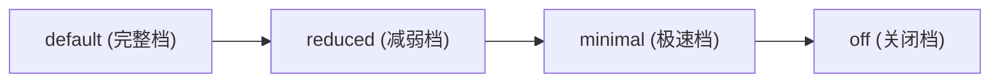

# 聚乐桌游 · 平台权威前端设计规范 (Platform Design System Spec)

本文档是聚乐桌游（JoyTable）全平台前端 UI、游戏大厅、房间外壳、设置弹层、控制台、系统功能页以及新模块开发的**唯一权威视觉与交互规范手册 (Single Source of Truth)**。

**执行铁律**：后续所有新建页面、设置面板、模态弹窗、控制台与交互组件，必须严格无条件执行本规范。严禁在 JSX/TSX 中混入随意字面量样式、冷灰扁平框或未对齐的内联暗黑样式。

---

## 1. 核心视觉哲学：实体复古纸质桌游 (Tactile Retro-Party Style)

聚乐桌游的核心设计语言是**「实体复古纸质桌游 (Tactile Retro-Party Style)」**。  
我们拒绝冰冷生硬的通用后台感与千篇一律的无质感扁平风，致力于唤醒玩家在线下聚会中围坐桌边**摸牌、翻卡、掷骰、拍钟**的真实触觉反馈与快乐。

### 1.1 核心隐喻与设计基因
- **温暖羊皮纸基底 (Warm Parchment Paper)**：全平台以柔和温暖的纸质色调为底，营造如实体派对桌游说明书和游戏卡牌般的自然亲和力。
- **粗墨黑实体轮廓 (Heavy Solid Inking)**：所有卡片、容器、控件均采用高辨识度的纯墨黑实体描边（`3px / 2.5px`），呈现经典美漫与实体木盒桌游的硬派印制风格。
- **实体硬下沉投影 (Tactile Drop-Flat Shadow)**：放弃模糊柔和的现代发散投影，全面采用硬切角实体偏移投影（`0 5px 0` / `0 3px 0`）。
- **按压实体物理回馈 (Mechanical Tactile Feedback)**：按钮与可点卡片在悬浮（Hover）时轻盈上浮并拉长投影，按下（Active）时物理下沉并收敛阴影至 `1px`，如实体机械按键般扎实清脆。

---

## 2. 全平台权威设计令牌系统 (Design Tokens - `--gp-*`)

平台已将早期分散的 `--home-*` 与 `--game-*` 统一收敛至 **`--gp-*` (Game Platform)** 命名空间。  
`packages/client/src/shared-ui/game-ui.css` 为本令牌系统的代码级唯一权威实现源。

### 2.1 基础调色板 (Core Palette)

| 令牌名称 | 变量名 / 权威色值 | 视觉含义与适用场景 | 对比度基准 |
|---|---|---|---|
| **底纸暖色** | `--gp-paper: #fff4df` | 全局外层底色、温暖纸张基底 | 对深墨黑 13.8:1 |
| **卡片主体** | `--gp-surface: #fffdf7` | 功能卡片、面板、输入框背景 | 对深墨黑 15.2:1 |
| **加强卡面** | `--gp-surface-strong: #fffaf0` | 嵌套子面板、次级卡片背景 | 对深墨黑 14.6:1 |
| **深墨黑** | `--gp-ink: #292722` | 核心文字正文、标题、图标主色 | 权威前景色 |
| **实体轮廓** | `--gp-line: #292722` | 所有实体边框描边、硬投影基准色 | 与 `--gp-ink` 同源 |
| **次级说明** | `--gp-muted: #575147` | 辅助文字、字段描述、未选中态 | 对浅底 $\ge 7:1$ |
| **活力明黄** | `--gp-yellow: #f7c84b` | 唯一主导 CTA 按钮、倒计时底色、高亮徽章 | 搭配深墨黑字 8.8:1 |
| **派对珊瑚红**| `--gp-coral: #c23616` | 危险操作、紧迫倒计时、选中态胶囊、重点强调 | 搭配纯白字 5.1:1 |
| **深珊瑚红**| `--gp-coral-dark: #a12b11`| 珊瑚红的按压/深色交互态 | 搭配纯白字 6.8:1 |
| **森林墨绿**| `--gp-green: #08715d` | 连接成功状态、已就绪、房主身份徽章 | 搭配纯白字 5.3:1 |
| **深墨绿** | `--gp-green-dark: #055848`| 墨绿的深色激活态 | 搭配纯白字 7.8:1 |
| **神秘派对紫**| `--gp-purple: #7358a7` | 角色/身份特异性标签、特殊模式标记 | 搭配纯白字 4.8:1 |
| **语义危险红**| `--gp-danger: #dc2626` | 致命操作、彻底销毁、严重错误 | 搭配纯白字 4.6:1 |
| **语义成功绿**| `--gp-success: #16a34a`| 快速通用成功提示 | 搭配纯白字 4.5:1 |
| **语义警告橙**| `--gp-warning: #f59e0b`| 提示性警示、网络波动 | 搭配深墨黑字 7.4:1 |

### 2.2 命名空间收敛与兼容映射
为了杜绝历史上由于多人协作产生的色值分裂，CSS 顶层已将既有旧命名强制映射到统一源：
```css
/* 严禁再在代码中新增字面量颜色，必须通过标准令牌引用 */
--game-paper: var(--gp-paper);
--game-surface: var(--gp-surface);
--game-ink: var(--gp-ink);
--game-line: var(--gp-line);
--game-coral: var(--gp-coral);
--game-yellow: var(--gp-yellow);
--game-green: var(--gp-green);

--home-paper: var(--gp-paper);
--home-surface: var(--gp-surface);
--home-ink: var(--gp-ink);
--home-coral: var(--gp-coral);
--home-yellow: var(--gp-yellow);
--home-green: var(--gp-green);
```

### 2.3 几何与实体触觉令牌 (Tactile Geometry)

```css
:root {
  /* 圆角规格体系 */
  --gp-radius-sm: 10px;      /* 小型徽章、微操作按钮、输入框内部件 */
  --gp-radius-md: 14px;      /* 标准按钮、次级容器、选项卡 */
  --gp-radius-lg: 20px;      /* 核心主面板、大弹窗外壳、状态大卡 */
  --gp-radius-pill: 999px;   /* 胶囊 Chip、主 CTA 药丸钮、状态指示标签 */

  /* 实体描边规格 */
  --gp-border: 3px solid var(--gp-line);     /* 核心卡片、面板、主导按钮标准边框 */
  --gp-border-sm: 2.5px solid var(--gp-line);/* 小型按钮、输入框、微型卡片描边 */

  /* 实体硬下沉投影体系 */
  --gp-shadow-sm: 0 3px 0 var(--gp-line);    /* 小型控件、微型按钮、悬浮标签默认态 */
  --gp-shadow: 0 5px 0 var(--gp-line);       /* 标准面板、大卡片、按钮悬停态 */
  --gp-shadow-lg: 0 7px 0 var(--gp-line);    /* 模态浮层、核心结算抽屉、高悬浮卡片 */
  --gp-shadow-press: 0 1px 0 var(--gp-line); /* 实体按键下沉（Active）紧贴态 */

  /* 触控与无障碍尺寸 */
  --gp-touch: 44px;                          /* 移动端严格最低触控点击热区 */

  /* 顶栏外壳描边配方 */
  --gp-chrome-line: var(--gp-ink);
  --gp-chrome-width: 2.5px;
  --gp-chrome-line-inverse: rgba(255, 255, 255, 0.16);
  --gp-chrome-width-inverse: 1.5px;

  /* 全局统一字体栈 */
  --gp-font: "PingFang SC", "Hiragino Sans GB", "Microsoft YaHei", system-ui, sans-serif;
}
```

---

## 3. 动效分级与时序系统 (Motion System & Tiers)

动效不仅是视觉点缀，更是界面的**状态传达者与触觉放大器**。平台动效遵循**「高响应、小形变、物理回弹」**原则，严禁拖沓漫长的缓动。

### 3.1 权威动效时间与缓动令牌

| 令牌名称 | 数值 | 使用场景 |
|---|---|---|
| `--gp-dur-instant` | `90ms` | 纯色彩切换、边框色变更、快速高亮激活 |
| `--gp-dur-fast` | `140ms` | 按钮悬停上浮与按压下沉、微型开关切换 |
| `--gp-dur-standard` | `220ms` | 卡片折叠/展开、普通浮层淡入、Tab 内容切换 |
| `--gp-dur-emphasis` | `320ms` | 模态弹窗弹出、成功徽章弹出、重点结果展示 |
| `--gp-dur-phase` | `420ms` | 游戏阶段昼夜交替转场、舞台主场景切换 |
| `--gp-dur-slow` | `480ms` | 终局复盘网格大画幅依次入场 |
| `--gp-dur-ambient` | `5.2s` | 仅在默认档位开启的环境柔和循环微动 |

**缓动曲线**：
- 标准：`--gp-ease-standard: cubic-bezier(0.22, 1, 0.36, 1)`（平滑出入）
- 减速进场：`--gp-ease-decelerate: cubic-bezier(0.16, 1, 0.3, 1)`
- 机械按压：`--gp-ease-press: cubic-bezier(0.34, 1.56, 0.64, 1)`（带轻微实体回弹）

### 3.2 4 级动效模式契约 (Motion Accessibility Modes)

用户可在系统设置中随时切换动效档位，通过 `html[data-motion-level]` 全局生效：



1. **`default`（默认完整档）**：
   - 完整享受纸牌微弹跳、粒子呼吸、装饰性环境动画。
2. **`reduced`（动效减弱档）**：
   - 时长压缩 35-40%（如 standard 降为 160ms）；
   - **严格停用装饰性无限循环动画**：包括背景星光漂移、灯光光晕、横幅呼吸、彩带微动等；
   - **保留关键任务反馈**：回合光晕（`.tabletop-turn-halo`）、发言波纹、倒计时紧迫脉冲、可出牌高亮指示不受影响，保障游戏可玩性。
3. **`minimal`（极速微动效档）**：
   - 所有动画时长压至 `1ms`，位移归 `0px`，专为低性能设备与极速操作场景设计。
4. **`off`（彻底关闭档）**：
   - 时长 `0ms`，彻底禁用一切过渡，状态即时切变。

---

## 4. 强制可读性与响应式断点契约 (Contrast & Responsive Contract)

### 4.1 视觉对比度强制硬指标 (WCAG AA/AAA)
来自 `AGENTS.md` 的平台级不可逾越之红线：
1. **对比度硬性阈值**：
   - 正文与常规控件文字：对比度**必须 $\ge 4.5:1$**（WCAG AA）；
   - 大号标题与加粗文本：对比度**必须 $\ge 3:1$**；
   - 关键操作按钮、倒计时、状态警示：**强烈建议 $\ge 7:1$**（WCAG AAA）。
2. **绝对杜绝低对比度反模式**：
   - ❌ 严禁在羊皮纸底（`#fff4df`）或白底上使用浅灰、浅米、低饱和浅黄文字；
   - ❌ 严禁在暗夜底、深木纹上使用深灰、深蓝、暗暗的文字；
   - ❌ 严禁按钮底色与页面背景过度融合导致按钮“隐形”。
3. **复杂桌布底纹防眩光保护**：
   - 游戏牌桌普遍带有桌布纹理、木纹底纹、插画或动态光影。
   - 文字与控件下方必须提供半透明毛玻璃底板、纯色遮罩卡片（`rgba(255, 253, 247, 0.92)` / `backdrop-filter: blur(8px)`），或附带严密的文字阴影保护（`text-shadow: 0 1px 2px rgba(0,0,0,0.6)`），彻底防止底图纹理干扰阅读。

### 4.2 严格响应式断点契约 (Responsive Breakpoints Contract)
平台前端**仅允许**使用以下既定断点，严禁引入任何非白名单的自定义媒体查询数值：

| 维度 | 断点数值 | 典型设备场景与响应策略 |
|---|---|---|
| **宽度** | `@media (min-width: 380px)` | 超小屏紧凑手机：采用单列流式，压缩内边距至 10-12px |
| | `@media (min-width: 480px)` | 标准主流手机（竖屏）：双列卡片，标准触控热区 |
| | `@media (min-width: 640px)` | 大屏手机 / 折叠屏展开：允许操作区左右并排分栏 |
| | `@media (min-width: 768px)` | 平板竖屏 / 桌面小窗口：弹出侧边抽屉，显示完整状态栏 |
| | `@media (min-width: 1024px)`| 平板横屏 / 笔电屏幕：开启多列网格，大舞台沉浸排版 |
| | `@media (min-width: 1280px)`| 桌面大屏显示器：限制最大容器宽度，居中对齐 |
| **高度** | `@media (min-height: 520px)`| 矮屏手机横屏：折叠非关键顶部横幅，压缩垂直间距 |
| | `@media (min-height: 620px)`| 标准横屏高度：恢复完整座位环绕与扇形手牌完整张角 |

---

## 5. 双层图标与视觉资产体系 (/oil-icon & /draw-ui)

平台采用清晰的分工体系，兼顾矢量界面的轻量锐利与实体桌游卡面的丰富艺术感：

```
                    ┌──────────────────────────────────────────────┐
                    │          平台双层图标与视觉资产体系          │
                    └──────────────────────┬───────────────────────┘
                                           │
                    ┌──────────────────────┴───────────────────────┐
                    ▼                                              ▼
    【Tier 1：功能与导航图标】                     【Tier 2：业务卡片/角色头像/徽章/插画】
      · 来源：lucide-react 矢量图标                  · 来源：/oil-icon 与 /draw-ui 规范生成
      · 尺寸：16px / 20px / 24px                     · 尺寸：64px / 128px / 256px 或 4x4 Sheet
      · 属性：stroke-width: 2.5px                   · 风格：实体复古桌游玩具感 (粗描边+色板锁定)
      · 颜色：绑定 currentColor / --gp-ink          · 交付：平底灰(#808080)切图，透明 PNG / WebP
```

### 5.1 Tier 1：功能操作与导航图标 (Lucide 矢量规范)
- **统一度量**：
  - 工具栏 / 次级操作：`16px` (`size={16}`)
  - 标准按钮前缀图标：`18px - 20px` (`size={18}`)
  - 独立导航大图标：`24px` (`size={24}`)
- **线宽一致性**：强制声明 `strokeWidth={2.5}`，确保矢量线条粗细与实体纸牌墨线完美呼应。
- **色彩规范**：严格继承父级前景色（`stroke="currentColor"`），随按钮状态（激活、悬浮、禁用）自然渐变，禁止硬编码不受控的第三方彩色。

### 5.2 Tier 2：业务卡片、角色头像、徽章与空状态资产 (/oil-icon)
针对游戏卡牌封面、角色头像、结算胜利徽章、空状态插画，遵循 `/oil-icon` 与 `/draw-ui` 约束：

#### 1. 风格锁定 (Frozen Style Spec)
- **风格名称**：`retro-boardgame-tactile`
- **笔触与轮廓**：粗墨黑实体描边（2.5px - 3px 视觉当量），转角带有圆润木质/注塑玩具倒角；
- **材质质感**：实体平涂（Solid Fill），搭配高对比色块，允许轻微纸张微颗粒肌理，杜绝廉价现代半透明渐变；
- **色板锁定 (Palette-Lock)**：生成提示词中必须锁定在平台权威色板中：
  `Palette locked: #fff4df, #fffdf7, #292722, #f7c84b, #c23616, #08715d, #7358a7`。

#### 2. 批次生成与切图管线 (4x4 Sheet Pipeline)
- **同构保证**：必须以 **4x4 网格（16格）**在平底灰色背景（`#808080`）上单张统一生成，确保整组图标的光照角度、笔触厚度与比例尺绝对一致。
- **切图与抠图**：
  - 使用 `floodfill`（硬边缘模式）或 `rembg` 处理背景透明；
  - **QA 验收硬指标**：将切出的透明 PNG 置于品红（`#ff00ff`）或青色高对比背景上审查，彻底杜绝留存灰色杂边或相邻格子残影渗漏。

#### 3. 提示词工程构建标准 (Prompt Guidelines)
- **类比法为主**：`Think tactile wooden boardgame token with solid black contour line, printed on warm matte parchment.`
- **清单法罗列实体隐喻**：明确指出具体具象物体（如“铜质怀表”、“硬壳奶酪”、“木质锤子”），避免空洞的抽象概念。
- **严禁事项**：
  - ❌ 禁止在 prompt 中书写具体 CSS 像素（如 `16px padding`）；
  - ❌ 禁止全黑填充（Never make black filled icons）——黑色只作为粗轮廓线与深色文字，填充必须使用平台明亮活力色；
  - ❌ 字符数严格控制在 800 字以内。

---

## 6. 前端信息架构与交互硬契约 (/oil-frontend)

本章规范直接指导所有前端 TSX 组件与页面状态开发，防止低质页面反模式：

### 6.1 资源身份三要素 (Resource Identity)
用户在列表中识别任何业务对象（玩家、房间、历史对局、游戏卡片），必须一眼看到最小可辨识组合：
1. **视觉标识**：头像插画 / 游戏卡牌封面；
2. **权威名称**：用户昵称 / 游戏中文全称；
3. **关键区分字段**：当前座位号 / 房间连接延迟 / 胜率标签（杜绝裸露展示 UUID 等无意义机器编码）。

### 6.2 消除伪操作 (Fake Action Zero Tolerance)
- 界面上的每一个操作按钮必须产生**真实的系统状态变更或持久化保存**。
- 严禁出现“点击后仅仅修改了当前组件内存 state，一旦刷新页面立即打回原形”的伪保存按钮。
- 无法执行的操作必须明确告知原因或通过权限隐藏，禁止摆放永久 disabled 且无提示的占位伪控件。

### 6.3 单一主导动作原则 (Dominant Action)
- 任何一个独立的页面视口、模态弹窗或卡片操作区，**只允许出现且仅出现 1 个高强调主导按钮（Primary CTA）**（通常为 `--gp-yellow` 主明黄实体药丸钮）。
- 次级操作必须收敛为幽灵按钮（`.gp-btn--ghost`）、次要微操作胶囊（`.gp-chip`）或文字链，防止多个高饱和色块互抢视线造成用户认知负荷过载。

### 6.4 提交边界与局部最小忙碌范围
- **提交边界明确化**：
  - 实时调整项（如声音音量滑块、动效档位切换）：即时生效并写入持久存储，无需额外确定键；
  - 表单编辑项（如服务器地址配置、自定义词库录入）：必须有明确的统一提交边界与返回反馈。
- **局部最小忙碌范围**：
  - 异步请求进行中，**仅在被点击的具体按钮内展示微型 Spinner 或将该项置为 busy**；
  - 严禁无脑唤起全屏半透明灰色大遮罩，阻断用户的全局浏览视野。

### 6.5 状态互斥完整覆盖 (State Coverage)
任何列表或异步数据容器，必须互斥覆盖以下 6 大状态，杜绝界面白屏或无反馈假死：
1. `loading`：实体复古纸牌跳动或进度胶囊；
2. `ready`：正常加载完成并渲染主内容；
3. `empty`：无任何数据时的实体插画引导与“新建”主导按钮；
4. `filtered-empty`：用户搜索/筛选无结果，明确提示“未找到匹配项”并提供“一键重置筛选”；
5. `processing`：操作提交中，控件保持局部忙碌；
6. `error`：明确展示“发生了什么”+“如何修复或一键重试”。

---

## 7. 平台标准组件规格与代码配方 (Component Recipes)

### 7.1 统一主导按钮与按钮矩阵 (`.gp-btn`)

```css
/* 标准按钮基础基底 */
.gp-btn {
  display: inline-flex;
  align-items: center;
  justify-content: center;
  gap: 8px;
  min-height: var(--gp-touch);
  padding: 8px 24px;
  border: var(--gp-border-sm);
  border-radius: var(--gp-radius-pill);
  background: var(--gp-surface);
  color: var(--gp-ink);
  font-family: var(--gp-font);
  font-size: 0.92rem;
  font-weight: 900;
  box-shadow: var(--gp-shadow-sm);
  cursor: pointer;
  white-space: nowrap;
  user-select: none;
  transition:
    transform var(--gp-dur-fast) var(--gp-ease-press),
    box-shadow var(--gp-dur-fast) var(--gp-ease-press),
    background var(--gp-dur-instant) ease;
}

/* 悬浮轻盈上浮 2px，阴影拉厚 */
.gp-btn:hover:not(:disabled) {
  transform: translateY(-2px);
  box-shadow: var(--gp-shadow);
}

/* 按压下沉 2px，阴影压紧至 1px，模拟物理按键触底 */
.gp-btn:active:not(:disabled) {
  transform: translateY(2px);
  box-shadow: var(--gp-shadow-press);
}

/* 按钮变体 */
.gp-btn--primary { background: var(--gp-yellow); color: var(--gp-ink); }
.gp-btn--coral   { background: var(--gp-coral);  color: #ffffff; }
.gp-btn--green   { background: var(--gp-green);  color: #ffffff; }
.gp-btn--ghost   { background: var(--gp-surface); color: var(--gp-ink); }
.gp-btn--danger  { background: var(--gp-danger); color: #ffffff; }

/* 紧凑小型尺寸 */
.gp-btn--sm {
  min-height: 34px;
  padding: 4px 14px;
  font-size: 0.78rem;
  border-radius: var(--gp-radius-sm);
}
```

### 7.2 标准内容面板 (`.gp-panel`)

```css
.gp-panel {
  width: 100%;
  box-sizing: border-box;
  padding: 16px 20px;
  border: var(--gp-border);
  border-radius: var(--gp-radius-lg);
  background: var(--gp-surface);
  color: var(--gp-ink);
  box-shadow: var(--gp-shadow);
}

.gp-panel__head {
  display: flex;
  align-items: center;
  justify-content: space-between;
  gap: 12px;
  padding-bottom: 10px;
  margin-bottom: 14px;
  border-bottom: 2px solid color-mix(in srgb, var(--gp-muted) 25%, transparent);
}

.gp-panel__title {
  margin: 0;
  font-size: 1.05rem;
  font-weight: 900;
  color: var(--gp-ink);
}
```

### 7.3 卡片二选一/多选选择器 (`.choice-card`)

```css
.choice-card {
  display: flex;
  flex-direction: column;
  align-items: flex-start;
  gap: 8px;
  padding: 16px;
  border-radius: var(--gp-radius-md);
  border: var(--gp-border-sm);
  background: var(--gp-surface);
  box-shadow: var(--gp-shadow-sm);
  cursor: pointer;
  transition: all var(--gp-dur-fast) var(--gp-ease-standard);
}

.choice-card:hover {
  transform: translateY(-2px);
  box-shadow: var(--gp-shadow);
}

.choice-card.is-selected {
  background: #ecfdf5;
  border-color: var(--gp-green);
  box-shadow: 0 0 0 2px var(--gp-green), var(--gp-shadow-sm);
}
```

### 7.4 表单输入框 (`.text-input` / `.gp-input`)

```css
.gp-input {
  width: 100%;
  padding: 10px 16px;
  border-radius: var(--gp-radius-md);
  border: var(--gp-border-sm);
  font-size: 0.92rem;
  font-weight: 700;
  color: var(--gp-ink);
  background: #ffffff;
  box-shadow: 0 2px 0 var(--gp-line);
  outline: none;
  box-sizing: border-box;
  transition: border-color var(--gp-dur-instant) ease;
}

.gp-input:focus {
  border-color: var(--gp-green);
  box-shadow: 0 0 0 2px var(--gp-green), 0 2px 0 var(--gp-line);
}
```

---

## 8. 底层舞台与引擎规范索引 (Tabletop Engine Index)

为了保证主设计规范的清晰凝练，涉及游戏舞台的物理仿真力学、三维渲染管线与核心手牌展开算法，统一索引并委托至专精子规范：

👉 **[局域网桌游平台前端设计系统与交互规范 (`docs/TABLETOP_DESIGN_SYSTEM.md`)](file:///d:/项目/docs/TABLETOP_DESIGN_SYSTEM.md)**

该规范深度覆盖以下核心专精领域：
1. **视口零横向溢出与外层滚动条彻底消除**：`html`, `body`, `#root`, `.game-page` 等外层视口严禁产生页面级水平横向滚动或外部滚动条；
2. **5px 专有桌游美学细滑块规范**：仅在长发言记录、聊天历史局部开启，日间采用琥珀半透明胶囊轨道；
3. **ThreeDiceCupCanvas 3D 物理与骰盅引擎**：
   - 弹簧双轴掀盖退让力学（右后方退让不挡视线）；
   - PCFShadowMap 柔光箱环境光与各向异性 512px 材质；
   - 物理与 `WebAudioManager` 清脆碰撞音效精确纳秒级同步；
   - 闲置时主动切断 `requestAnimationFrame` 极致休眠按需渲染。
4. **CardFanEngine 手牌动态扇区算法**：
   - 动态贝塞尔圆弧展开算法；
   - 移动端卡牌 $\ge 5$ 张时自动平滑回退至高度 $\le 36\text{px}$ 紧凑条（Compact Ribbon）；
   - 出牌 180ms 飞出锁（切断并发并平滑消除双击 Bug）；
   - `useId` 防止多张相同手牌 SVG 滤镜/渐变冲突。
5. **通用开局转场与结算坞 (Universal Flow Transitions)**：
   - 绿色水波爆发（Ripple Blast）$\to$ 彩色百叶窗横扫 $\to$ 平滑揭幕；
   - 底部全屏结算坞（就绪联动、全员准备 3 秒极速重开）。

---

## 9. 规范实施 Do's and Don'ts 总结速查表

| 维度 | ✅ 强烈提倡 (DO) | ❌ 严厉禁止 (DON'T) |
|---|---|---|
| **颜色与调色板** | 严格从 `--gp-*` 令牌中引用颜色；前景色与背景色满足 WCAG 4.5:1 | 严禁自创未封装的冷灰 `#6b7280`、生硬纯红 `#ff0000` 或内联裸色 |
| **容器与边框** | 实体深墨黑描边（`3px / 2.5px`）+ 实体平下沉投影（`0 5px 0`） | 严禁单薄 1px 浅灰细线框或无下沉投影的生硬扁平灰卡片 |
| **交互动效** | 遵循 `--gp-dur-*` 令牌，按钮按下必须物理下沉 2px 并压缩阴影 | 严禁拖沓漫长的缓动（>500ms），严禁在 reduced 模式下持续播放装饰循环 |
| **图标体系** | 功能图标用 Lucide (stroke: 2.5px)；业务卡片用 4x4 色板锁定实体复古图 | 严禁在功能导航处使用模糊光栅位图，严禁生成全黑大色块图标 |
| **前端状态** | 互斥覆盖 loading / empty / error；唯一主导按钮；局部最小忙碌 | 严禁全屏打断式 Loading 遮罩；严禁伪保存按钮；严禁多个并列刺眼主操作 |
| **响应式适配** | 严格对齐 380/480/640/768/1024/1280px 与 520/620px 白名单断点 | 严禁在 CSS 中随意写入 500px、900px 等非标准魔数断点 |
| **视口与滚动** | 外层单屏沉浸，零横向溢出；局部内部长内容使用 5px 美学细滑块 | 严禁页面级出现双重滚动条或手机端横向被撑开横滑 |
